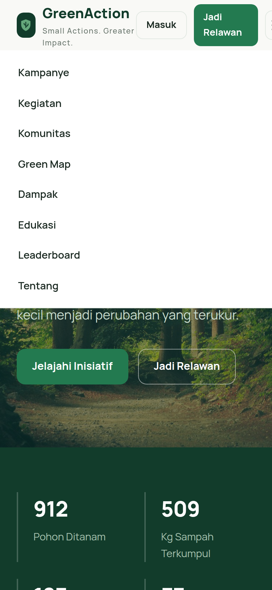

# GreenAction — National Environmental Innovation & Sustainability Platform

**Small Actions. Greater Impact.**


**Created & Developed By: Dika X Dev**

GreenAction merupakan proyek yang diinisiasi, dirancang, dan dikembangkan oleh Dika (Dika X Dev) sebagai platform teknologi lingkungan untuk mendorong partisipasi masyarakat dalam menciptakan perubahan positif melalui aksi nyata.

---

## 1. Project Overview

GreenAction adalah platform web environmental technology yang menghubungkan masyarakat, relawan, komunitas, institusi pendidikan, dan organisasi lingkungan dalam satu ekosistem: menemukan masalah, mempelajari solusi, mengikuti kegiatan, membangun komunitas, melaporkan permasalahan lingkungan, dan memantau kontribusi.

- **Nama:** GreenAction
- **Tagline:** Small Actions. Greater Impact.
- **Kategori:** Environmental Technology & Sustainability Platform
- **Konteks:** Kompetisi olimpiade web design nasional

## 2. About GreenAction

GreenAction bukan sekadar platform edukasi — ini adalah pusat kolaborasi lingkungan yang mengintegrasikan kampanye, kegiatan sosial, pelaporan masalah lingkungan, edukasi, komunitas, tantangan (Eco Challenge), dan pengukuran dampak (Impact Analytics).

## 3. Background & Problem Statement

Platform ini menjawab 7 masalah:

1. Rendahnya partisipasi masyarakat dalam kegiatan lingkungan
2. Sulit menemukan kegiatan sosial dan lingkungan
3. Kurangnya transparansi dampak kegiatan
4. Tidak adanya pencatatan kontribusi individu
5. Kurangnya edukasi pengelolaan sampah
6. Sulitnya melaporkan masalah lingkungan
7. Kurangnya koneksi antara relawan dan organisasi lingkungan

## 4. Goals & Innovation

- **Goals:** menaikkan partisipasi, menyatukan discovery kegiatan, membuat dampak transparan, mencatat kontribusi individu.
- **Innovation:** Green Map interaktif (Leaflet + OpenStreetMap), sistem poin relawan berjenjang (Seedling → Forest Keeper), alur verifikasi laporan 6 tahap, pemisahan eksplisit antara *poin partisipasi* dan *dampak terverifikasi*, serta pelabelan jujur "data demo" pada seluruh statistik publik.

## 5. Main Features

| Fitur | Status | Keterangan |
|---|---|---|
| Homepage | ✅ Jalan | Hero, statistik (demo), pillars, CTA |
| Campaign Management | ✅ Jalan | Direktori + detail + search/filter/sort + save/bookmark |
| Activities & Volunteer | ✅ Jalan | Katalog kegiatan + kuota + pendaftaran (approval) |
| Community Directory | ✅ Jalan | Profil komunitas terverifikasi + kegiatan terkait |
| Green Map | ✅ Jalan | Leaflet + OSM, filter 7 kategori titik |
| Eco Challenge | ✅ Jalan | 6 tantangan, progress harian, streak, poin |
| Environmental Reporting | ✅ Jalan | Form + upload foto (maks 2MB) + alur status 6 tahap |
| Impact Analytics | ✅ Jalan | Chart.js — 4 grafik, berlabel data demo |
| User Dashboard | ✅ Jalan | KPI, grafik, riwayat join & laporan, tantangan |
| Profile | ✅ Jalan | Level relawan + edit lokasi |
| Admin Dashboard | ✅ Jalan | Stats, antrian verifikasi laporan, approval join, daftar user |
| Leaderboard | ✅ Jalan | Ranking poin relawan |
| Education | ✅ Jalan | Artikel edukasi dengan sumber tercantum |
| Auth | ✅ Jalan | Register/login/logout, scrypt hash, session token |

## 6. Screenshots

| | |
|---|---|
|  |  |
|  |  |

## 7. Technology Stack

- **Backend:** Node.js 22 + Express 5 (production server, bukan dev server)
- **Database:** JSON file storage (atomic write via tmp+rename) — tanpa dependency eksternal
- **Frontend:** Vanilla HTML/CSS/JS, design tokens custom, font Manrope
- **Peta:** Leaflet 1.9 + OpenStreetMap tiles
- **Grafik:** Chart.js 4 (CDN)
- **Keamanan:** scrypt password hash, timing-safe compare, session token (crypto.randomBytes), rate limiting per-IP, upload limit 2MB

## 8. Architecture

```
Browser (multi-page HTML + GA.js helper)
   │  fetch /api/*  (Bearer token)
   ▼
Express server (server.js, port 9100)
   ├── Static public/ + clean URLs
   ├── API router (public data, auth, user actions, admin)
   ├── Rate limiter middleware
   └── JSON file DB (data/*.json, atomic writes)
```

## 9. Folder Structure

```
greenaction/
├── server.js              # Express server + API + static
├── package.json
├── .env.example
├── .gitignore
├── README.md
├── data/                  # JSON DB (di-ignore jika berisi data privat)
├── uploads/               # (reserved) file upload
├── docs/screenshots/      # Screenshot aktual
└── public/
    ├── css/style.css      # Design system (tokens, components, responsive)
    ├── js/app.js          # GA helper (api, auth, header/footer, toast)
    ├── img/               # Foto Unsplash (lihat Credits)
    └── *.html             # 20 halaman
```

## 10. System Requirements

- Node.js ≥ 18 (diuji di Node 22)
- 100MB disk
- Port 9100 tersedia

## 11. Installation Guide

```bash
git clone <repository-url> greenaction
cd greenaction
npm install
cp .env.example .env   # edit sesuai kebutuhan
npm start              # atau: node server.js
```

## 12. Environment Configuration

Salin `.env.example` → `.env`:

```
PORT=9100
HOST=0.0.0.0
```

Tidak ada secret lain yang dibutuhkan (tidak ada API key eksternal wajib). Jangan commit file `.env` asli.

## 13. Getting Started

1. `npm start`
2. Buka `http://localhost:9100`
3. Daftar akun relawan, atau login admin demo (lihat Admin Guide)

## 14. User Guide

- **Jelajahi:** Kampanye, Kegiatan, Komunitas, Green Map, Edukasi — semua bisa dilihat tanpa login.
- **Ikut serta:** login dulu → klik *Daftar* pada kegiatan/kampanye (status Pending sampai admin menyetujui).
- **Eco Challenge:** mulai tantangan → catat progres harian (7 hari) → poin otomatis.
- **Lapor:** halaman Lapor → isi form (+ foto opsional ≤2MB) → pantau status di dashboard.
- **Poin & Level:** kontribusi disetujui +20 poin; level naik: Seedling → Sprout → Sapling → Guardian → Forest Keeper.

## 15. Admin Guide

Akun admin demo:

- Email: `admin@greenaction.id`
- Password: `admin123`

⚠️ *Khusus deployment kompetisi/demo. Ganti atau hapus akun ini untuk produksi nyata.*

Admin Dashboard (`/admin`) menyediakan: statistik platform, grafik pertumbuhan user & laporan, **antrian verifikasi laporan** (Review → Verify / Tolak), **approval pendaftaran kegiatan** (setuju/tolak — menambah poin user & kuota kegiatan), dan daftar semua pengguna.

## 16. API Documentation

Base: `/api`. Format JSON. Auth: header `Authorization: Bearer <token>`.

### Auth
| Method | Endpoint | Keterangan |
|---|---|---|
| POST | `/auth/register` | {nama, email, password, kota, provinsi} — rate limit 10/menit |
| POST | `/auth/login` | {email, password} — rate limit 15/menit |
| POST | `/auth/logout` | hapus sesi |
| GET | `/auth/me` | profil user aktif |

### Data publik
GET `/campaigns` (query: kategori, q, sort) · GET `/campaigns/:id` · GET `/activities[/:id]` · GET `/communities[/:id]` · GET `/challenges` · GET `/articles[/:id]` · GET `/mappoints` · GET `/stats` · GET `/leaderboard` · GET `/reports`

### Aksi user (butuh login)
| Method | Endpoint | Keterangan |
|---|---|---|
| POST | `/join` | {type: campaign/activity, id} |
| GET | `/my/joins` · `/my/reports` · `/my/challenges` · `/my/saved` · `/me` | data milik user |
| POST | `/reports` | laporan lingkungan (foto base64 maks 2MB) — rate limit 5/menit |
| POST | `/challenges/:id/progress` | catat progres harian |
| POST | `/saved/toggle` | simpan/hapus bookmark |
| POST | `/me/profile` | update kota/provinsi |

### Admin (role admin)
| Method | Endpoint | Keterangan |
|---|---|---|
| GET | `/admin/data` | agregat stats + laporan + joins + users |
| GET | `/admin/overview` · `/admin/joins` | ringkasan |
| POST | `/admin/joins/:key` | {status: Approved/Rejected} → +20 poin user |
| POST | `/admin/reports/:id` | {status} 6 tahap verifikasi |
| POST | `/admin/campaigns` | tambah kampanye |
| DELETE | `/admin/campaigns/:id` · `/activities/:id` · `/users/:id` | hapus data |

## 17. Database Structure

JSON file di `data/`:

| File | Isi |
|---|---|
| users.json | akun (password ter-hash scrypt `salt:hash`) |
| campaigns.json / activities.json / communities.json | data program |
| challenges.json / achievements.json | tantangan & progres user |
| reports.json | laporan lingkungan + status |
| joinreqs.json | pendaftaran user |
| saveditems.json | bookmark per user |
| mappoints.json | titik Green Map |
| articles.json | artikel edukasi |
| stats.json | agregat dampak |

Write bersifat atomik (`.tmp` → `rename`) sehingga data tidak hilang saat restart.

## 18. Security & Privacy

- Password di-hash scrypt (salt acak per user), diverifikasi timing-safe
- Session token acak 24 byte, expiry 7 hari
- Rate limiting: auth 10–15/menit, laporan 5/menit, join 20/menit (per IP)
- Upload foto dibatasi 2MB, hanya JPG/PNG
- Endpoint admin dijaga middleware role (teruji: token user biasa → **403**)
- Identitas pelapor tidak diekspos di daftar laporan publik
- Tidak ada secret di source code; `.env` di-gitignore

## 19. Testing Results

Diuji langsung di browser + curl (lokal, port 9100):

- ✅ Semua route 200: `/`, `/kampanye`, `/kegiatan`, `/komunitas`, `/green-map`, `/tantangan`, `/lapor`, `/dampak`, `/edukasi`, `/papan-peringkat`, `/tentang`, `/masuk`, `/daftar`, `/dashboard`, `/profil`, `/admin`, detail pages; route tak dikenal → 404 custom
- ✅ Register → login → join → lapor → challenge progress → admin approve → poin user bertambah (+20 terverifikasi)
- ✅ Guard admin: token user biasa akses `/api/admin/data` → **403**
- ✅ Rate limiting aktif pada auth & laporan
- ✅ Persistence: data bertahan setelah server restart (poin tetap 20)
- ✅ Foto semua card ter-load (naturalWidth > 0)
- ✅ Responsive: burger menu tampil & berfungsi di viewport 390px; layout hero & statistik menyesuaikan
- ✅ Login redirect: admin → `/admin.html`, user → `/dashboard.html`
- ✅ Screenshot aktual tersimpan di `docs/screenshots/`

## 20. Known Limitations

- **Data demo:** kampanye, kegiatan, komunitas, titik map, artikel, dan statistik dampak adalah dataset demo berlabel jujur — bukan data organisasi nyata. Laporan & akun yang dibuat pengunjung adalah data nyata.
- Database JSON cocok untuk skala kompetisi/demo, bukan produksi besar.
- Sesi token in-memory: user perlu login ulang setelah server restart (data tetap aman).
- Upload foto disimpan sebagai base64 di DB (batas 2MB).
- Tidak ada email verifikasi.

## 21. Roadmap

- Migrasi ke SQLite/PostgreSQL + autentikasi refresh token persisten
- Notifikasi email (verifikasi akun & update status laporan)
- Integrasi peta dengan data OpenStreetMap nyata (bank sampah terverifikasi)
- Mobile app (React Native/Flutter)
- Multi-bahasa (ID/EN)

## 22. Credits & References

**Foto:** Unsplash ([Unsplash License](https://unsplash.com/license)) — kategori: hutan tropis, laut, daur ulang, panel surya, penanaman pohon, komunitas. Foto diunduh via CDN `images.unsplash.com` dan disimpan di `public/img/`.

**Referensi desain (prinsip, bukan salinan):** WWF, The Nature Conservancy, UNEP, Ecosia, Ecosystem Restoration Communities.

**Peta:** © OpenStreetMap contributors (ODbL). **Grafik:** Chart.js (MIT). **Peta lib:** Leaflet (BSD-2). **Font:** Manrope (OFL).

## 23. License

MIT License — bebas digunakan dengan atribusi.

## 24. Contributors

- **Dika (Dika X Dev)** — Project Creator, Product Design, Full-Stack Development, QA.
- Aset pihak ketiga (foto Unsplash, peta OSM, library open-source) dikreditkan di bagian Credits — tidak ada kontribusi kode dari pihak lain.

## 25. Project Creator & Developer Identity

**Created & Developed By: Dika X Dev**

> GreenAction merupakan proyek yang diinisiasi, dirancang, dan dikembangkan oleh Dika (Dika X Dev) sebagai platform teknologi lingkungan untuk mendorong partisipasi masyarakat dalam menciptakan perubahan positif melalui aksi nyata.

Peran: Project Creator & Lead Developer.
